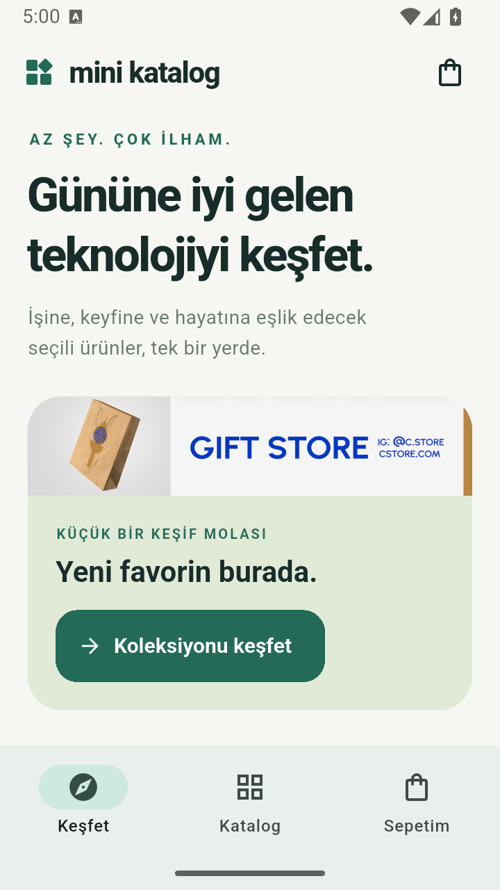
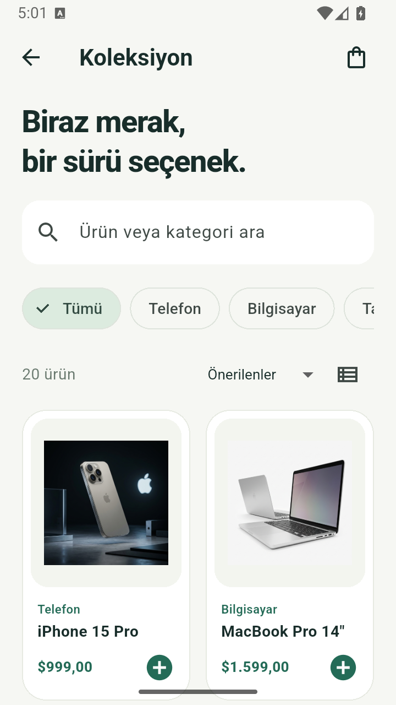
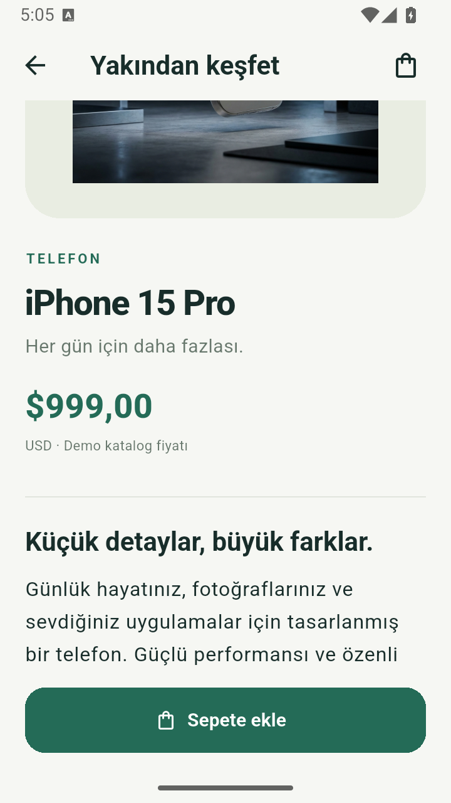
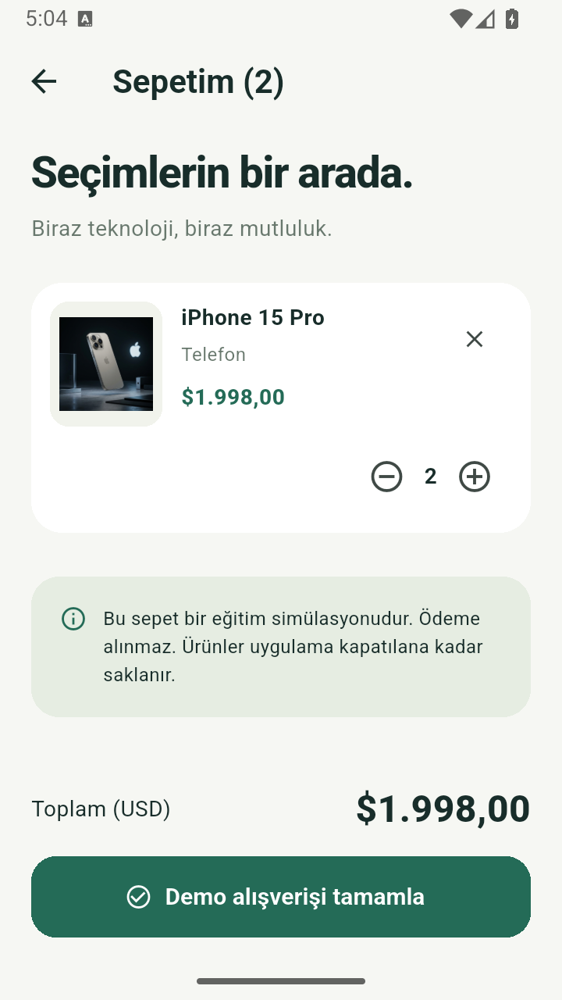
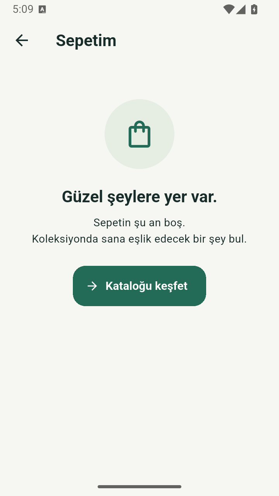
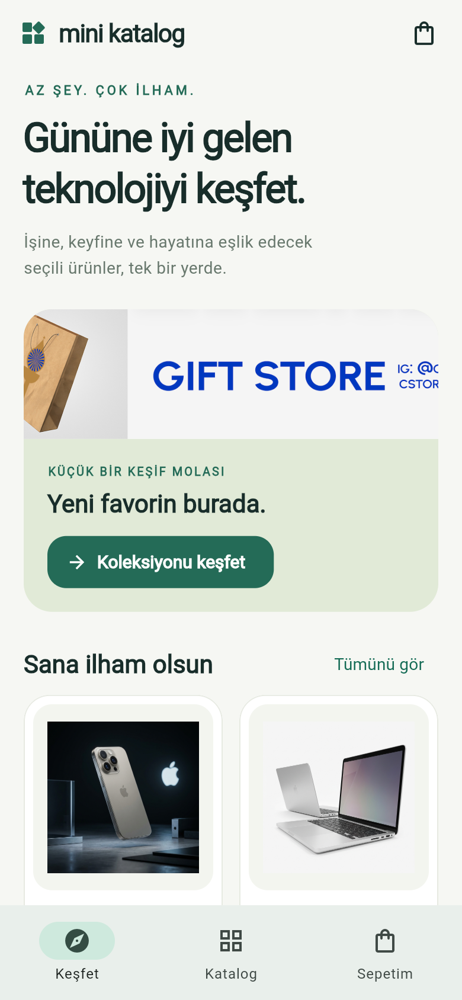
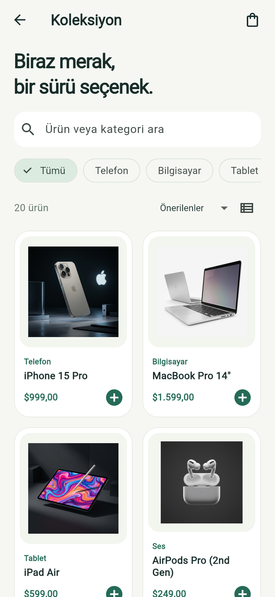
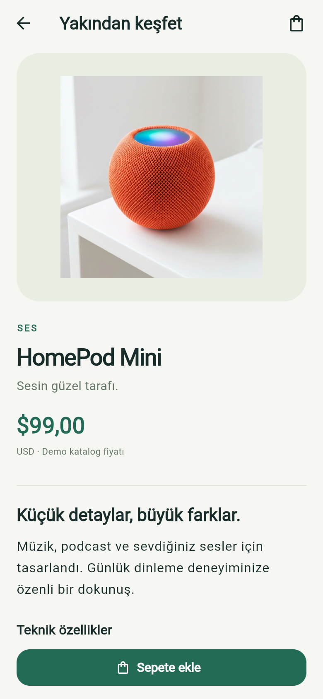
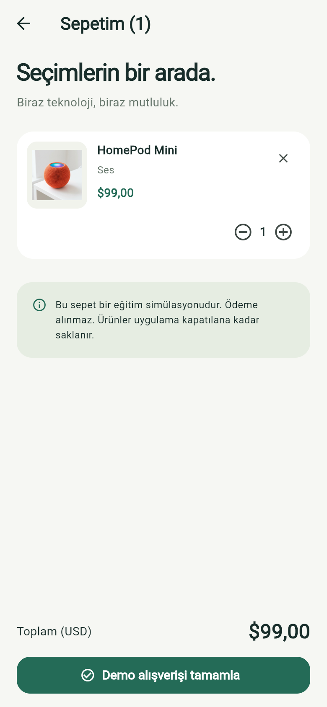

# Mini Katalog

Flutter ile geliştirilen, Türkçe arayüzlü mobil ürün kataloğu ve sepet simülasyonu. Yönergedeki 20 demo ürün, JSON verisi ve görselleriyle uygulamaya gömülüdür. Uygulama çalışırken internet bağlantısı gerekmez.

## Özellikler

- Keşfet ana sayfası, banner ve ürün önerileri
- GridView ürün kartları ve ListView liste görünümü
- Ürün/kategori arama, kategori filtresi, fiyat/ad sıralaması
- Görsel, açıklama, fiyat ve teknik özelliklerle ürün detayı
- Navigator, MaterialPageRoute ve RouteSettings.arguments ile ürün aktarımı
- Oturum içi sepet: ekle, adedi artır/azalt, kaldır ve toplamı hesapla
- Onay/iptal içeren demo alışveriş; gerçek ödeme veya sipariş oluşturmaz
- Yükleme, hata/yeniden dene, boş arama ve boş sepet durumları

## Sürümler

Geliştirme ve doğrulama: **Flutter 3.50.0 stable**, **Dart 3.14.0**.

Çalışma zamanı bağımlılığı yalnızca Flutter SDK'dır. Yönerge gereği `package:flutter/material.dart` kullanılır. Flutter 3.50 bu import'u deprecated işaretlediği için ilgili satırlarda gerekçeli analiz istisnası vardır; `material_ui` gibi ek bir paket eklenmemiştir. Testlerde SDK'nın `flutter_test` aracı kullanılır. SDK'nın kendi geçişli bağımlılıkları normaldir.

## Çalıştırma

Flutter SDK'yı [resmî kurulum belgesine](https://docs.flutter.dev/install) göre kurun. Android için Android Studio, Android SDK ve emülatör veya USB hata ayıklaması açık fiziksel cihaz gerekir. iOS için macOS ve Xcode gerekir.

```sh
flutter --version
flutter doctor
flutter pub get
flutter devices
flutter run -d <cihaz-kimliği>
```

Tarayıcıda çalıştırmak için `flutter run -d chrome` kullanın.

Yerel SDK `.tools/flutter` altında mevcutsa aşağıdaki Windows yardımcısı onu kullanır; aksi durumda PATH üzerindeki Flutter'ı çalıştırır:

```powershell
powershell -ExecutionPolicy Bypass -File scripts/flutter.ps1 run -d chrome
```

Yerel release önizlemesi (Node.js gerekir; derler ve sunucuyu açık tutar):

```powershell
powershell -ExecutionPolicy Bypass -File scripts/run-web.ps1
```

Adres: http://127.0.0.1:8080. Durdurmak için Ctrl+C. `.tools` ve önbellekler teslim kaynaklarına dahil edilmez; başka makinede normal Flutter kurulumu kullanılır.

Android SDK, Java ve `Mini_Katalog` sanal cihazının yerel olarak hazırlandığı çalışma kopyasında, çalışan emülatörde uygulamayı açmak için:

```powershell
powershell -ExecutionPolicy Bypass -File scripts/flutter.ps1 run -d emulator-5554
```

Emülatör kapalıysa `powershell -ExecutionPolicy Bypass -File scripts/start-emulator.ps1` ile başlatılabilir. Başka makinede Android Studio Device Manager üzerinden bir cihaz oluşturulmalıdır.

## Doğrulama

```sh
flutter analyze
flutter test
flutter build web --release --no-web-resources-cdn
```

Yerel Windows SDK ile `flutter` yerine `powershell -ExecutionPolicy Bypass -File scripts/flutter.ps1` kullanılabilir.

Testler JSON dönüşümü ve görselleri, birleşik arama/filtre/sıralamayı, fiyat biçimini, sepet adet ve toplamlarını, detay navigasyonunu, demo onay/iptalini ve liste görünümünü kapsar. Tarayıcı kontrolü gerçek release web derlemesinde yapılmıştır. [Gereksinim eşlemesi](docs/GEREKSINIMLER.md).

**Android doğrulaması:** API 36 ile debug APK derlenmiş, Android 15 (API 35), x86_64 ve 16 KB bellek sayfalı emülatöre kurulup çalıştırılmıştır. Katalog, ürün detayı, sepet, adet/toplam, iptal/onay ve geri dönüş kontrol edilmiştir. [Android test kaydı](docs/ANDROID_TEST.md).

**Sınır:** Fiziksel telefon ve iOS testi yapılmamıştır. Üretilen debug APK x86_64 emülatör içindir. Sepet uygulama kapanınca sıfırlanır. Fiyatlar USD demo verisidir; güncel satış teklifi değildir.

## Ekran görüntüleri

Android 15 emülatöründen alınan gerçek uygulama ekranları (720 × 1280):

| Ana sayfa | Katalog |
| --- | --- |
|  |  |
| Ürün detayı (kaydırılmış) | Sepet |
|  |  |
| Demo sonrası boş sepet | |
|  | |

Web önizlemesi:

Gerçek Flutter web uygulamasından 390 × 844 mobil görünümde alınmıştır; emülatör görüntüsü değildir.

| Ana sayfa | Katalog |
| --- | --- |
|  |  |
| Ürün detayı | Sepet |
|  |  |

## Klasör yapısı

```text
lib/
  main.dart                    # Uygulama girişi
  app.dart                     # Veri yükleme ve route tanımları
  models/product.dart          # fromJson / toJson
  data/catalog_repository.dart # rootBundle ile JSON okuma
  state/cart_controller.dart   # ChangeNotifier ile sepet durumu
  screens/                     # Ana sayfa, katalog, detay, sepet
  widgets/                     # Ortak kart, görsel, boş durum ve düzen
  theme/                       # Material teması
  utils/                       # Arama, sıralama, fiyat biçimi
assets/data/products.json
assets/images/
test/
docs/screenshots/
android/
ios/
web/
```

## Kaynaklar

[Demo ürün verisi](https://wantapi.com/products.php) ve [banner](https://wantapi.com/assets/banner.png), yönergede belirtilen kaynaktan indirilmiştir. Kategori ve Türkçe açıklamalar eklenmiştir. [Görsel ve marka notları](assets/SOURCES.md).

[Flutter kurulum](https://docs.flutter.dev/install/manual), [route arguments](https://docs.flutter.dev/cookbook/navigation/navigate-with-arguments) ve SDK kaynak kodu incelenmiştir. Güncel Flutter çoğu uygulama için named routes yerine başka yöntemler önerse de bu eğitim projesi yönergedeki Navigator/Route Arguments yaklaşımını uygular.

`node scripts/prepare-assets.mjs` kaynak veriyi yeniden indirebilir. Uygulamayı çalıştırmak için gerekli değildir.

## Teslim

Kaynak kod, README, web/Android ekran görüntüleri ve Android emülatör testi hazırlanmıştır. GitHub'da hazırlanan depoya kaynaklar yüklenmeli; teslimde depo herkese açık olmalı ve URL paylaşılmalıdır. Depoya `.tools`, önbellekler, `tmp` ve `build` klasörü yüklenmemelidir.
